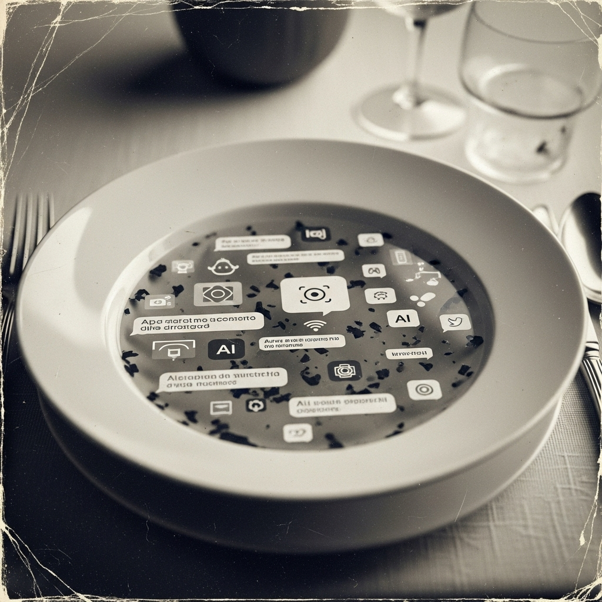

# Zuppa di prompt



Una raccolta personale di ricette per lavorare con gli agenti di intelligenza artificiale. Ogni ricetta è un modo per regolare il comportamento di un agente, oppure ciò che l'agente ci restituisce: un prompt, una skill, una mod, una configurazione. Ognuna è annotata quel tanto che basta per rifarla da capo su un altro computer.

Oggi le ricette sono soprattutto per **Claude Code** e **Antigravity CLI**, i due agenti con cui lavoro ogni giorno, nella didattica e nel resto del mio lavoro. La raccolta però non si fermerà a questi due.

La cucina, come la cibernetica, è una questione di retroazione: si assaggia, si corregge, si assaggia di nuovo. Per questo nessuna ricetta qui è definitiva. Il repository è nato il 7 dicembre 2024 come quaderno di esperimenti. Nell'ottobre 2026 l'ho ripulito e ricominciato da capo.

## Le ricette

| Cartella | Per | Ricette |
|---|---|---|
| [`Claude/`](Claude/) | Claude Code | [context-bar](Claude/context-bar.md): la finestra di contesto e i crediti consumati, sempre visibili sopra il prompt |
| [`Gemini/`](Gemini/) | Antigravity CLI e Gemini | ancora nessuna |
| — | Claude Code, Antigravity CLI e Gemini CLI | [Athena](Athena.md): costruire e gestire un corso con Obsidian e un agente. Vive in un [repository tutto suo](https://github.com/davideriboli/Athena) |

Ogni ricetta è un file markdown che spiega a che cosa serve, come si installa e, quando serve, contiene il prompt per farla ricostruire all'agente. Se la ricetta ha del codice, questo sta in una cartella accanto, con lo stesso nome.

Le mod di Claude Code si installano direttamente da qui: il repository fa anche da catalogo di plugin. Per esempio:

```
/plugin install context-bar --marketplace davideriboli/Zuppa-di-prompt
```

## Licenza

[MIT](LICENSE): le ricette si possono prendere, cambiare e ridistribuire liberamente, purché resti la nota sull'autore.

— Davide Riboli
